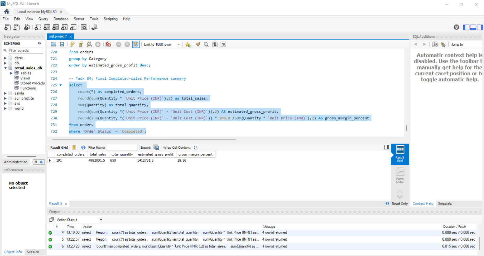
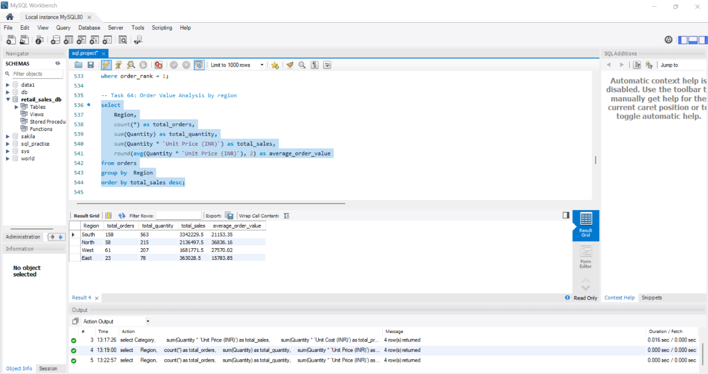
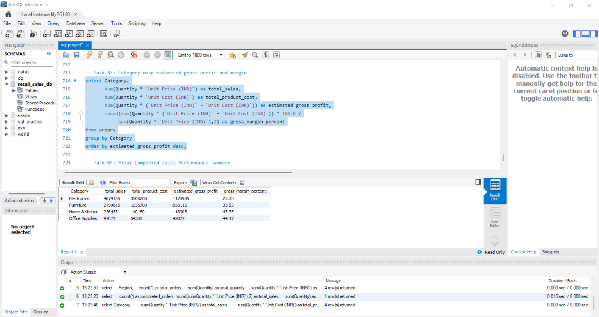

# Retail Sales Analysis using SQL

## Project Overview
This project focuses on analysing retail sales data using MySQL to identify sales trends, customer behaviour, product performance, and business insights.

## Tools Used
- MySQL
- MySQL Workbench

## Dataset
- Total Records: 300
- Domain: Retail Sales

## SQL Concepts Used
- SELECT, WHERE, ORDER BY, DISTINCT
- Aggregate Functions
- GROUP BY and HAVING
- CASE Statements
- Joins
- Subqueries and CTEs
- Window Functions
- Data Analysis and Business Insights

## Key Business Insights
- Total completed sales: ₹49,82,001.50
- Estimated gross profit: ₹14,12,731.50
- Gross profit margin: 28.36%
- South region recorded the highest sales.
- Electronics was the highest sales-generating category.
- Consumer segment contributed the highest completed sales.

## Project Objective
To apply SQL skills to real-world business questions and generate meaningful insights that can support data-driven decision-making.

## Author
Monish R

## SQL Analysis Screenshots

### 1. Final Completed Sales Performance Summary

### 2. Order Value Analysis by Region

### 3. Category-wise Estimated Gross Profit and Margin

